# Arquitectura del Sistema — Cubiora (PMV v1.0)

## 1. Visión General
Cubiora es un sistema web presencial de gestión de turnos para entrega de medicamentos en farmacias hospitalarias y dispensarios. Su arquitectura sigue un diseño de **Monolito Modular** enfocado en mantenibilidad, bajo acoplamiento y estricta seguridad en datos de pacientes.

### Flujo Tecnológico Oficial
La implementación oficial y única del flujo del sistema es:
**`React → NestJS → PrismaPg (@prisma/adapter-pg) → PostgreSQL 18.6 → SSE (Server-Sent Events)`**

Queda estrictamente prohibida cualquier referencia o asunción de "API MySQL". Toda la capa de persistencia está construida y estandarizada sobre PostgreSQL 18.6 con TLS obligatorio (`rejectUnauthorized: true`, verificación de CA interna y hostname), pooling PgBouncer compatible (`pg_isready`), y segregación de roles de mínimo privilegio (`cubiora_app` para DML sin DDL; `cubiora_migrator` exclusivo para migraciones).

---

## 2. Diagrama de Arquitectura

```mermaid
flowchart TB
    subgraph Clientes ["Clientes Web (Navegador)"]
        Recepcion["Recepción (/recepcion)<br/>Creación de Turnos"]
        Cajero["Atención (/cajero)<br/>Llamado y Cierre"]
        Pantalla["Pantalla Sala (/pantalla)<br/>Pública - Sin PII"]
    end

    subgraph Edge ["Capa Perimetral"]
        Nginx["Nginx / Reverse Proxy<br/>Cabeceras de Seguridad (CSP, HSTS)"]
    end

    subgraph Backend ["Monolito Modular (NestJS 12)"]
        subgraph Pipeline ["Pipeline Común"]
            CorrId["CorrelationIdMiddleware<br/>(X-Correlation-ID)"]
            Helmet["Helmet Security Headers"]
            ValidPipe["ValidationPipe<br/>(forbidNonWhitelisted)"]
            GlobalFilter["GlobalExceptionFilter<br/>(Sin stacktraces)"]
            LogInter["LoggingInterceptor<br/>(Audit & Métricas)"]
        end

        subgraph Modulos ["Módulos de Dominio"]
            HealthMod["HealthModule<br/>/health/live & /ready"]
            AuthMod["AuthModule<br/>Sesiones Seguras"]
            TicketsMod["TicketsModule<br/>Emisión de Tickets"]
            QueueMod["QueueModule<br/>Cola FIFO"]
            CubiclesMod["CubiclesModule<br/>Estado de Cubículos"]
            CallsMod["CallsModule<br/>Llamados & Reintentos"]
            DisplayMod["PublicDisplayModule<br/>SSE Streaming"]
            AuditMod["AuditMod<br/>Log Inmutable"]
        end

        subgraph ORM ["Capa de Datos"]
            PrismaService["Prisma 7 Client<br/>Driver Adapter @prisma/adapter-pg"]
        end
    end

    subgraph Database ["Base de Datos PostgreSQL 18.6"]
        subgraph Dev ["Desarrollo Local"]
            LocalPG["PostgreSQL 18 Nativo (Windows localhost) / Docker efímero<br/>cubiora_dev:5432"]
        end
        subgraph CI ["Integración Continua"]
            CIPG["Servicio postgres:18-alpine<br/>localhost:5432"]
        end
        subgraph Prod ["Producción"]
            ProdPG["Servidor PostgreSQL 18.6 Dedicado<br/>Roles de mínimo privilegio: cubiora_app / cubiora_migrator"]
        end
    end

    Clientes --> Nginx
    Nginx --> Pipeline
    Pipeline --> Modulos
    Modulos --> PrismaService
    PrismaService --> Database
```

---

## 3. Principios de Seguridad y Privacidad
1. **Privacidad Estricta en Pantalla Pública**: La pantalla de la sala de espera (`/pantalla`) y los eventos SSE nunca reciben ni muestran nombres ni documentos de pacientes (`patientName`, `patientDocument`).
2. **Defensa en Profundidad**: Sanitización global (`ValidationPipe` con `forbidNonWhitelisted: true`), protección contra Clickjacking (`X-Frame-Options`), inyección SQL prevenida vía Prisma, y encabezados de seguridad con Helmet.
3. **Mínimo Privilegio en Base de Datos**: Separación clara entre el usuario de migraciones (`cubiora_migrator`, con DDL) y el usuario de ejecución (`cubiora_app`, solo DML mínimo).
4. **Trazabilidad sin Fugas**: Cada petición porta un `X-Correlation-ID` correlacionado en logs, pero los errores devueltos a clientes ocultan cualquier traza o detalle técnico sensible.
